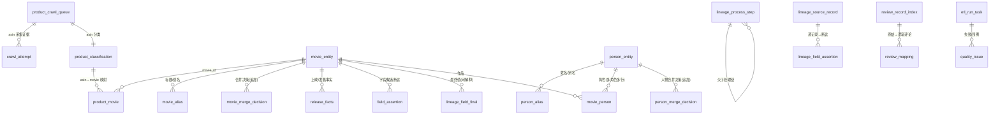

# ETL 数据模型：ER 图 · 建表脚本 · 键/约束/索引 · 字段字典

> 对应作业五/八节；建表脚本按序执行 `sql/01` … `sql/10`；运行器 `src/run_etl_local.py`；DAG `etl/dags/movie_etl_dag.py`。

## 1. ER 图（Mermaid）

核心实体：**movie_entity（作品）/ product_crawl_queue+product_classification（产品/版本 asin）/ person_entity（人物）/ review_record_index+review_mapping（评论）/ lineage_*（血缘）/ etl_run_task+quality_issue（运行与质量）**。评论→作品经 `product_movie(asin)` 间接关联（评论不复制，防重复计数）。

## 2. 建表脚本（执行顺序）

| 脚本 | 表 | 说明 |
|------|----|------|
| sql/01_crawl_queue.sql | product_crawl_queue | 采集队列（9 态互斥 CHECK） |
| sql/02_crawl_attempt.sql | crawl_attempt | 采集证据链（run_id+attempt_no） |
| sql/03_product_classification.sql | product_classification, product_movie_candidate | 分类 + 合集候选 |
| sql/04_movie_merge.sql | movie_entity, movie_alias, movie_merge_candidate/decision, product_movie, movie_merge_cluster_log | 电影合并 |
| sql/05_person_merge.sql | person_entity, person_alias, person_merge_candidate/decision, movie_person, person_cluster_log | 人物合并 |
| sql/06_release_completion.sql | release_facts | 上映信息补全（edition 域隔离） |
| sql/07_field_selection.sql | field_assertion | 字段候选/选定/拒绝/冲突 |
| sql/08_review_mapping.sql | review_record_index, review_mapping, review_anomaly | 评论去重 |
| sql/09_lineage.sql | lineage_source_record, lineage_field_assertion, lineage_field_final, lineage_process_step | 字段级血缘 |
| sql/10_etl_infra.sql | etl_run_task, quality_issue | 运行登记/质量事件（含软外键迁移） |

## 3. 键 / 约束 / 索引要点

- **主键**：asin（queue/classification）；movie_id/person_id（实体）；(asin,movie_id)（product_movie）；(asin,record_ordinal)（review 索引/映射）；(run_id,task_id,try_number)（运行登记）。
- **CHECK 约束**：状态机枚举（queue 9 态；classification 7 类×3 态；decision 4 态；assertion 4 态；map_status 3 态；issue_type 4 态）。
- **UNIQUE**：product_movie(asin,movie_id)；review_mapping(asin,record_ordinal)；field_assertion 候选唯一键（movie,field,value_norm,value_role,source,run_id）——幂等 upsert 依据。
- **索引**：状态/运行维度（queue(status,priority)、decision(run_id)、etl_run_task(run_id,state)）、血缘（assertion(entity,field)、source_record_id）、评论（h5_key/hfull_key/h_utex）。
- **外键策略**：reference 主链用软引用 + `quality_check.fk_orphan` 校验（重算重建允许暂态悬挂；演示证明重挂后归零）。product_movie→movie_entity 保留语义一致性校验。

## 4. 字段字典（核心表节选）

| 表.字段 | 类型 | 含义 | 来源/规则 |
|---------|------|------|-----------|
| product_classification.classification | TEXT(7) | 产品类别 | movie_classification_v0.1 |
| product_classification.evidence | JSONB | 页面/IMDb 信号+manual_review 标记 | 快照哈希定位 |
| movie_entity.movie_id | TEXT | 作品系统 ID（mv_ 序号） | 合并簇分配；重算后按成员集回写 |
| movie_entity.external_ids | JSONB | tconst 候选（来源定位，不充当 ID） | imdb |
| product_movie.relation_type | TEXT | single/collection_member | 合集多对多预留 |
| release_facts.fact_type | TEXT(5) | release_year/regional_release_date/**edition_sale_date**/earliest_review_time/inferred_release_bound | 语义分层（任务6） |
| release_facts.precision | TEXT | year/day/none | **仅年份不补 1 月 1 日** |
| field_assertion.status | TEXT(7) | candidate/selected/rejected/conflict + verified/inferred/missing | field_selection_rules_v1.0 |
| review_mapping.map_status | TEXT | unique/primary/duplicate_copy | 全字段逐字符一致才判重 |
| lineage_field_final.selected_assertion_uids | JSONB | 最终值可解释（候选集+理由） | 任务9 |
| etl_run_task.try_number | INT | 尝试序号 | 中断恢复依据 |
| quality_issue.issue_type | TEXT(4) | task_failed/check_violation/fk_orphan/count_mismatch | 失败处置 |

## 5. 幂等 / 中断恢复 / 规则版本变化（作业要求）

- **幂等**：所有写入为 UPSERT 或 (run_id) 全量重建；`run_etl_local.py` 成功 task 记 `etl_run_task.state=success`，重跑跳过；merge 重建时**快照人工决策→重放→按成员集回写 movie_id**，重跑前后实体/关系计数不变（演示证明）。
- **中断恢复**：失败 task 写 `quality_issue(task_failed)`；`--resume` 只补跑 failed/未跑 task，成功者不重做。
- **规则版本变化**：决策表（movie_merge_decision/person_merge_decision/field_assertion）**追加式**保留旧版本（rules_version+run_id 可查）；实体表 upsert 为当前生效版本。**重算受影响记录**：①查旧版本决策 `SELECT * FROM movie_merge_decision WHERE rules_version='merge_v1.2'`；②以新规则跑 merge（新 run_id 自动重放 manual 决策）；③新旧行为差异对照 decision 表两 run_id。示例：`movie_merge_decision` 现存 merge_v1.3×多 run_id 与 manual_confirm 行，历史决策零丢失。
